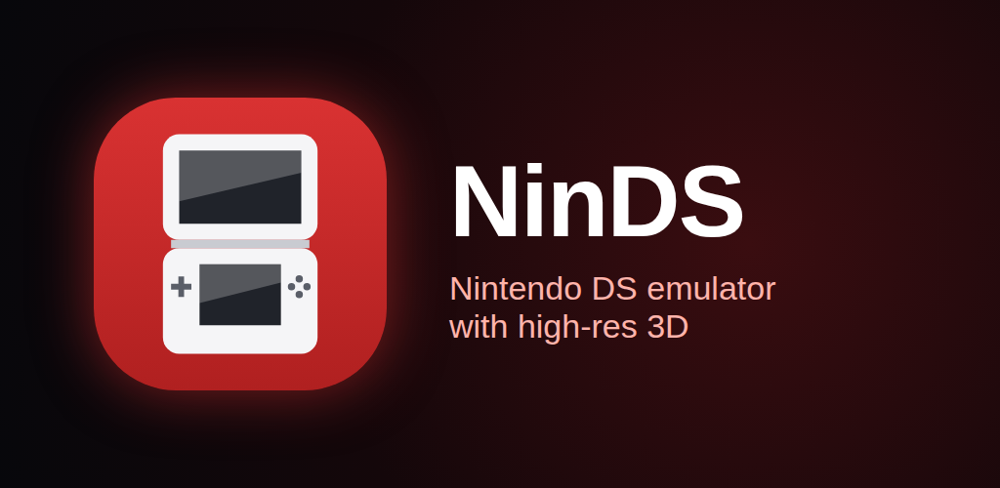

<p align="center"></p>

# NinDS

A Nintendo DS emulator for Android, built on [DSperate](https://github.com/beebono/DSperate), Noxwell's Nintendo DS emulator.

NinDS keeps DSperate's emulation core and replaces the desktop frontend with a native Android one. That frontend adds a game library with box art, on-screen touch controls, gamepad mapping, and a Vulkan renderer that draws 3D at up to 8x the DS's resolution. The core lives in [`src/`](src/) and the Android app in [`android/`](android/).

**Website:** [izzy2lost.com/ninds](https://www.izzy2lost.com/ninds) · **Privacy policy:** [izzy2lost.com/ninds-privacy](https://www.izzy2lost.com/ninds-privacy) · **Testing:** email [izzynochill@gmail.com](mailto:izzynochill@gmail.com?subject=NinDS%20Testing)

## Features

### Library

- Reads `.nds` and zipped games from any folder, through the Storage Access Framework, or opens one game at a time from a file manager.
- Shows each cartridge's banner icon and title, or switches to box art from the toolbar.
- Downloads box art and GameTDB titles on demand from [ds-covers](https://github.com/izzy2lost/ds-covers). If a game's own region has no cover, it borrows the same game's cover from another region.
- Long-press a game to resume where you left off, or to import, export or delete its save.

### Emulation

- ARM → AArch64 recompiler (JIT), fastmem, and melonDS-grade timing from the DSperate core.
- No BIOS dumps needed. A built-in FreeBIOS and a generated firmware start games directly. Your own `bios9.bin`, `bios7.bin` and `firmware.bin` are optional; they boot the DS system menu.
- **GPU 3D (Vulkan):**
  - Internal resolution: native, 2x, 3x, 4x, 6x or 8x.
  - Sub-pixel vertex precision.
  - 4x MSAA and smooth (bilinear) textures.
  - 2D layers stay pixel-exact on top.
- Software 3D renderer, pixel-exact with melonDS, as the default and the fallback.
- Action Replay cheats, typed in or picked from a `usrcheat.dat` database.
- Online play through Wiimmfi (off by default).

### Playing

- Layouts: stacked, side by side, hybrid, top only or bottom only, chosen separately for portrait and landscape, with swap and a screen gap.
- Filters: nearest, bilinear, sharp bilinear, LCD grid and 6x xBRZ, with optional integer scaling.
- Save states: eight slots with thumbnails, plus an automatic slot written on exit.
- Fast forward (held or toggled, 2x to unlimited) and frameskip (adaptive or fixed).
- Touch controls with haptics and adjustable size and opacity. They hide when a gamepad is in use.
- Gamepad and keyboard mapping, including hotkeys. The left stick can act as the d-pad.
- Lid close, screenshots to `Pictures/NinDS`, and an FPS counter.
- The DS user profile (nickname, message, birthday, colour, language) is set from Settings.

Requires **Android 9 (API 28) or later** on a **64-bit ARM** device. GPU 3D needs Vulkan 1.1.

## Where files live

App data sits under `Android/data/com.izzy2lost.ninds/files/`:

| Directory | Contents |
| --- | --- |
| `bios/` | Imported BIOS and firmware dumps |
| `saves/` | Battery saves (`<game>.sav`) |
| `states/<game>/` | Save states and their thumbnails |
| `cheats/` | Per-game cheat lists |
| `usrcheat.dat` | The imported cheat database |

Zipped games are unpacked once into the app's cache; Settings › Clear unpacked games frees that space.

## Compiling

Requires the Android SDK and a JDK, plus the toolchain Gradle pulls in:

| | Version |
| --- | --- |
| Android Gradle Plugin | 9.2.1 |
| Gradle | 9.4.1 |
| NDK | 30.0.15729638 |
| CMake | 3.30.3 |
| compileSdk / targetSdk | 36 |
| minSdk | 28 |

AGP 9 has built-in Kotlin support, so no Kotlin Gradle plugin is declared. The native library builds the core straight from `src/`, so there is nothing to fetch:

```sh
cd android
./gradlew assembleDebug      # app/build/outputs/apk/debug/app-debug.apk
./gradlew bundleRelease      # app/build/outputs/bundle/release/app-release.aab
```

Only `arm64-v8a` is built. Debug builds compile the native code optimised too, since the emulator is unusably slow at `-O0`. Release signing reads `android/key.properties`; see [`android/key.properties.example`](android/key.properties.example). The Play listing text and graphics are in [`android/play/`](android/play/).

The lean Vulkan raster's SPIR-V is checked in. After editing a shader under `src/core/gpu/vk/shaders`, run `tools/gen_lean_shaders.sh` and commit the blobs that changed.

### Layout

- `android/app/src/main/cpp/session.*`: the machine, its emulator thread, pacing, frameskip, saves, states, cheats
- `android/app/src/main/cpp/presenter_gl.*`: the GLES 3 presenter on its own vsync'd thread, with the filters and the high-resolution 3D composite
- `android/app/src/main/cpp/audio_out.*`: AAudio output, resampling the DS's 32728.5 Hz with drift correction
- `android/app/src/main/kotlin/`:
  - the library: SAF folder scan, banner icons, box art
  - the emulator activity, which runs in the `:emu` process and ends after each game
  - on-screen controls, controller mapping and settings

Settings live in `files/settings.properties`, not SharedPreferences, so the library process and the `:emu` process always agree.

For the core itself (its techniques, desktop and handheld builds, tests and tools), see upstream [DSperate](https://github.com/beebono/DSperate) and [docs/](docs/).

## Credits and licence

NinDS is licensed under the **GNU General Public License v3.0**; see [LICENSE](LICENSE).

- **[DSperate](https://github.com/beebono/DSperate)** by Noxwell (beebono): the emulator core and everything this port is built on. It is a clean-room reimplementation of DraStic's techniques, documented from DraStic's freely distributable debug build (by Exophase), and is verified against melonDS.
- **[melonDS](https://github.com/melonDS-emu/melonDS)** (GPL-3.0): the accuracy reference, and a source of code with attribution.
- **FreeBIOS** by Gilead Kutnick: the built-in BIOS replacement ([licence](src/core/bios/LICENSE.freebios)).
- **[Kronos](https://github.com/FCare/Kronos)** / **Yabause**: the 6x xBRZ shader in [`xbrz6x_shader.hpp`](android/app/src/main/cpp/xbrz6x_shader.hpp), under GPL-2.0-or-later.
- **[miniz](https://github.com/richgel999/miniz)**, **[ENet](https://github.com/lsalzman/enet)** and **[libslirp](https://gitlab.freedesktop.org/slirp/libslirp)**: zip reading, local wireless and the user-mode TCP/IP stack behind online play.
- **Noto Sans** and **WenQuanYi Micro Hei**: the DSi system fonts.
- **[GameTDB](https://www.gametdb.com)**: box art and game titles.

The app lists every component and its licence under Settings › About.

NinDS does not include any games, BIOS files or firmware. It is not affiliated with or endorsed by Nintendo; Nintendo DS and Nintendo DSi are trademarks of Nintendo.
